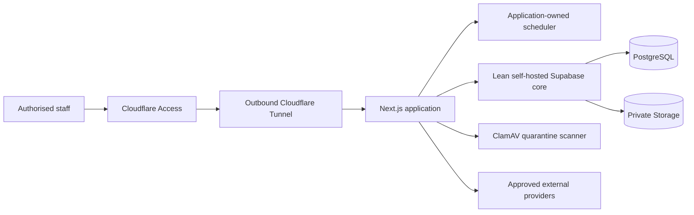

# Torrance Yachts Charter Operations Platform

A private, security-conscious operations platform for managing the complete
Torrance Yachts charter lifecycle: enquiry intake, offer preparation, bookings,
documents, task dependencies, payment reminders, charter operations and
post-charter follow-up.

## Release state

**Hosted activation in progress.** The shared application, database rules,
browser workflows, deployment package and Windows test companion are verified
through the repository CI gates. The service is not yet live: client-owned
provider configuration, staging acceptance, staff training and launch approval
remain deliberate operational gates.

Use only synthetic or sanitised data until those gates have been completed.

## What the platform provides

- A private, role-based workspace with approved accounts, TOTP MFA, Row Level
  Security and an append-only audit trail.
- A single PostgreSQL source of truth for contacts, yachts, enquiries, offers,
  bookings, documents, tasks, payments, notifications and workflow history.
- Human-controlled AI assistance for email classification, structured extraction,
  summaries and draft preparation. AI cannot send consequential messages,
  confirm bookings or reserve yachts.
- Buffered yacht availability, controlled booking changes and the documented
  0.A–7 charter task sequence.
- Private document quarantine, validation, scanning, release and retention-review
  controls.
- Per-user Google/Gmail, alert and AI settings, with encrypted provider
  credentials and a secure Telegram review flow.
- Controlled Gmail drafts, Calendar, Drive and Sheets adapters; PostgreSQL
  remains authoritative. Yachtfolio remains an auditable human task unless a
  supported integration is approved.
- An isolated tutorial and fictional end-to-end rehearsal for staff training.

## Architecture



The selected first hosted profile targets a cost-controlled Hetzner CX23. It
runs only the application, its bounded worker, PostgreSQL/Kong/Auth/REST/Storage
core, ClamAV and Cloudflare Tunnel. Studio, Realtime, analytics, edge functions,
image processing and a production n8n runtime are intentionally excluded. Local
n8n remains available for development and rehearsal only.

## Quality and release discipline

Every pull request runs five independent checks:

1. linting, strict TypeScript, production build and dependency audit;
2. migrations, Row Level Security tests and database linting;
3. Chromium, Firefox and WebKit acceptance scenarios;
4. automation, recovery, secret-boundary and production-container checks; and
5. Windows Tauri compile, test and unsigned installer packaging.

The complete local release gate is:

```powershell
npm run release:verify
```

It requires Node 24, npm 11.6.2, Docker Desktop, a clean checkout and no local
server occupying port 3000. It stops at the first failure and writes only
sanitised evidence to the ignored `.artifacts` directory.

## Local development

Requirements: Node.js 24 (see `.nvmrc`), npm, Docker Desktop and Git.

```powershell
npm ci
docker network create -o com.docker.network.bridge.host_binding_ipv4=127.0.0.1 torrance-yachts-local
npm run db:start
Copy-Item .env.example .env.local
npm run dev
```

The Docker-network command is a one-time setup. Populate the non-secret local
browser configuration from `npm run db:status`; never use the Supabase
service-role key in the application. Full bootstrap, recovery and local-network
guidance is in [Local development setup](docs/development/LOCAL_SETUP.md).

## Documentation

| Topic | Starting point |
| --- | --- |
| Product scope and business rules | [Project brief](docs/PROJECT_BRIEF.md) |
| Delivery state and remaining launch gates | [Completion register](docs/planning/PROJECT_COMPLETION_REGISTER.md) and [launch-gap register](docs/planning/LAUNCH_GAP_REGISTER.md) |
| Hosted architecture and activation | [Deployment architecture](docs/deployment.md), [production runbook](docs/operations/PRODUCTION_DEPLOYMENT.md) and [activation handoff](docs/operations/HOSTED_ACTIVATION_HANDOFF.md) |
| Daily operations and staff use | [Staff guide](docs/user-guide.md) and [operations guide](docs/operations.md) |
| Security and personal-state isolation | [Security policy](SECURITY.md) and [user-state isolation](docs/security/USER_STATE_ISOLATION.md) |
| Architecture, schema and decisions | [Architecture](docs/architecture), [database](docs/database) and [decision records](docs/decisions) |
| Verification, development record and portfolio | [Audit evidence](docs/audit), [development diary](docs/development) and [portfolio material](docs/portfolio) |

## Data handling

This repository must never contain live client data, emails, contact lists,
passports, KYC/CDD records, contracts, invoices, bank details, credentials or
current private commercial terms. All fixtures, screenshots and demonstrations
must be fictional or explicitly sanitised.

## Contributing

See [CONTRIBUTING.md](CONTRIBUTING.md) for the branch, validation, privacy and
pull-request expectations. This is a private internal-business repository;
access to source code does not authorise use of operational data.
