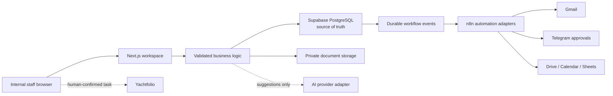

# Foundation architecture

## Status

Version `0.1.0` implements the application and documentation foundation. It intentionally does not connect external services or store real data.

## Current structure

```text
src/
  app/
    (workspace)/       Shared private-workspace route group
    [module]/          Validated foundation module route
    globals.css        Design tokens and global accessibility rules
    layout.tsx         Root metadata, font, and document layout
  components/
    dashboard/         Dashboard composition
    layout/            Workspace shell and navigation
    modules/           Shared module placeholder
    ui/                shadcn/ui source components
  config/              Navigation and module configuration
  lib/                 Synthetic fixtures and shared utilities
```

Application routes are server components by default. Only path-aware navigation and the mobile drawer are client components. This keeps browser JavaScript small and creates a safe boundary for future server-only database and integration code.

## Target system context



Planned integrations remain outside the trusted core. Their failures must not corrupt the authoritative database or silently repeat material actions.

## Design boundaries

- **Routing layer:** renders pages and layouts; it does not own business rules.
- **Presentation components:** display typed data and emit user intent.
- **Application/business layer (next milestone):** validates commands, state transitions, calculations, and permissions.
- **Data layer (next milestone):** owns database queries and private storage access.
- **Integration adapters (later milestones):** translate between core events and external providers.
- **Automation definitions (later milestones):** retryable, idempotent n8n workflows stored in version control.

## Security posture at this milestone

- No credentials or environment values are required.
- No database, mailbox, storage bucket, AI service, Telegram bot, or automation service is connected.
- All displayed records are synthetic fixtures.
- Metadata explicitly requests no indexing or following.
- The app is a local development preview and has no authentication boundary yet.

## Next architecture milestone

Introduce local Supabase tooling, migration-controlled PostgreSQL tables for users/yachts/contacts, generated TypeScript database types, authentication middleware/proxy appropriate to the installed Next.js version, and verified Row Level Security before any live data is considered.
