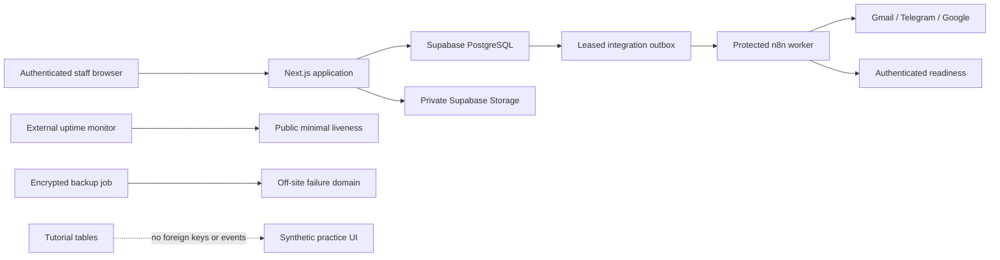

# Phase 12 launch-readiness and tutorial architecture

## Trust boundaries

The tutorial has no relationship to operational enquiries, bookings, documents,
notifications, or deliveries. Advancing or resetting it cannot create external
work. It stores only the current user's training stage and append-only history.

## Production gate

`launch_readiness_checks` contains the evidence-based client acceptance list.
Normal staff can read it. Only administrators can review a check through a
validated command. Required waivers remain visible and do not count as full
production approval.

The interface also reports whether required environment-variable names are
present, without exposing values. This is a configuration aid, not proof that a
credential has correct scope or ownership.

## Health model

- `/api/health/live` is intentionally minimal and unauthenticated for container
  and uptime checks.
- `/api/health/ready` uses a constant-time bearer secret and checks database
  connectivity, required configuration presence, failed deliveries, and recent
  restore evidence.
- production readiness returns HTTP 503 when required settings or a recent restore
  are missing.
- the version-controlled n8n monitor calls readiness every five minutes.

## Browser security

Proxy creates a unique nonce and a strict script Content Security Policy for every
dynamic request. The application also sets frame, MIME, referrer, browser-feature,
cross-origin, and production HSTS headers. Caddy limits request bodies and is the
only internet-facing service.
