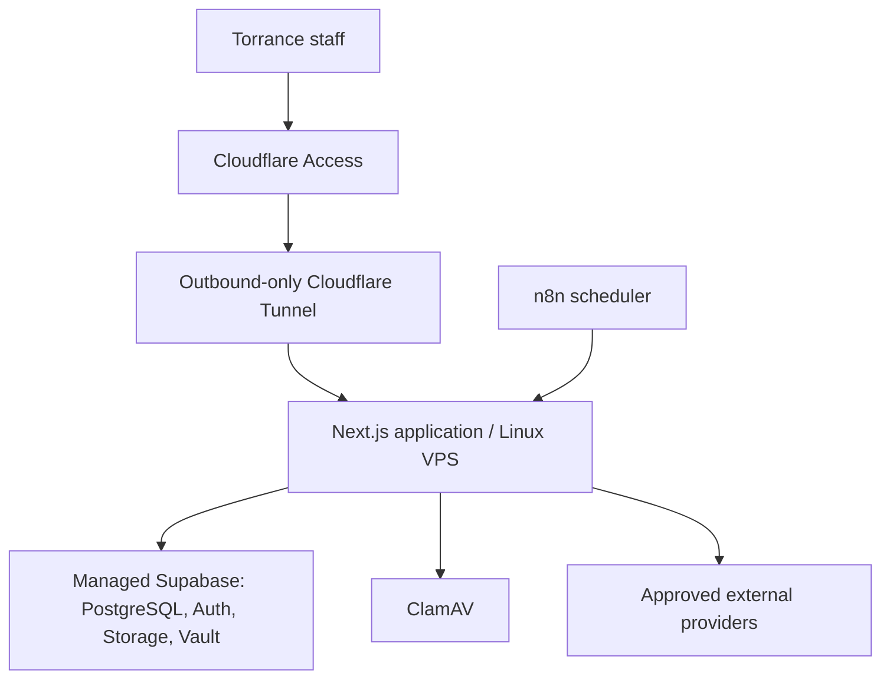
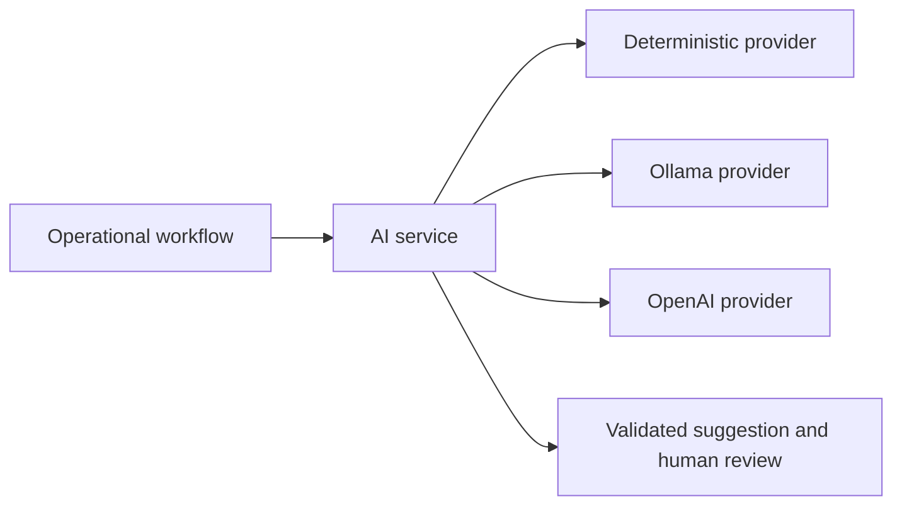

# Deployment architecture

The supported first production edition is a central hosted service. Employee
computers need only a browser; the optional desktop client remains a thin future
companion.





| Component | Development | Staging/production |
| --- | --- | --- |
| Next.js | local `npm run dev` | immutable standalone GHCR image on VPS |
| Supabase/PostgreSQL | local Docker | managed client-owned project |
| n8n | local Docker | pinned private VPS container |
| ClamAV | local Docker | private VPS container |
| Mailpit | local only | never deployed |
| SMTP | Mailpit capture | approved transactional SMTP |
| AI | deterministic/Ollama fixtures | explicit per-user provider |
| Ingress | loopback | Cloudflare Access + outbound Tunnel |
| Real data | prohibited | only after launch acceptance |

## Release artefacts

Next.js compiles browser-safe `NEXT_PUBLIC_*` values into the client bundle.
Accordingly, one image is never promoted between environments. A reviewed source
tag is built separately through GitHub Actions for `staging` and then, after
staging acceptance, for `production`:

```text
v0.19.1 source tag
  ├─ staging build    → ghcr.io/catsplat/torrance-yachts:staging-v0.19.1
  └─ production build → ghcr.io/catsplat/torrance-yachts:production-v0.19.1
```

Each build accepts only its GitHub environment's browser-safe Supabase URL and
publishable key. The deployment process verifies its intended-environment image
label, resolves it to a content digest and records that digest on the VPS. No
secret or service credential is baked into either image. See
[`ADR 0039`](decisions/0039-environment-specific-release-images.md).

Detailed provisioning, secrets, migrations and rollback are in
`docs/operations/PRODUCTION_DEPLOYMENT.md`.
