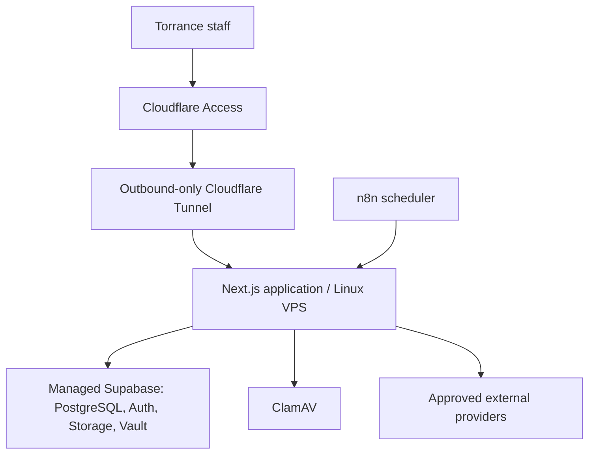
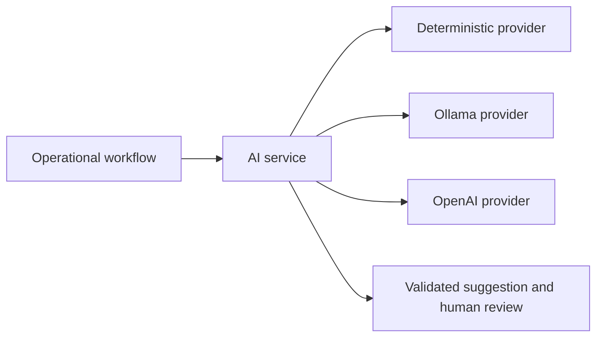

# Deployment architecture

The supported first production edition is a central hosted service. Employee
computers need only a browser; the optional desktop client remains a thin future
companion.

| Component | Development | Staging/production |
| --- | --- | --- |
| Next.js | local `npm run dev` | immutable standalone GHCR image on VPS |
| Supabase/PostgreSQL | local Docker | managed client-owned project |
| n8n | local Docker | pinned private VPS container |
| ClamAV | local Docker | private VPS container |
| Mailpit | local only | never deployed |
| SMTP | Mailpit capture | approved transactional SMTP |
| AI | deterministic/Ollama fixtures | explicit per-user provider |
| Ingress | loopback | Cloudflare Access + outbound Tunnel |
| Real data | prohibited | only after launch acceptance |

Detailed provisioning, secrets, migrations and rollback are in
`docs/operations/PRODUCTION_DEPLOYMENT.md`.

