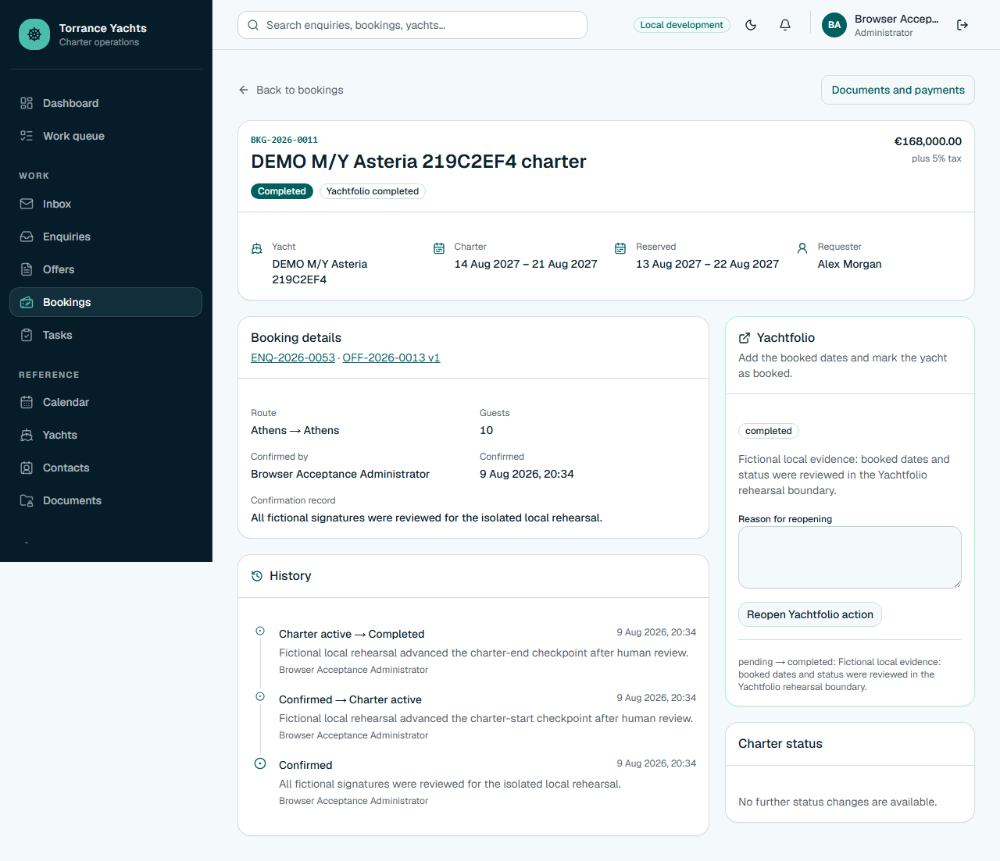

# Pre-deployment assurance case study

## Problem

The first twelve phases produced a working charter-operations platform, but a
feature list was not enough to justify deployment. Historical records needed to
remain discoverable, access needed stronger proof, provider setup needed one
clear path, private uploads needed recoverable scanning, and the complete client
workflow needed browser-level evidence.

## Approach

The release was treated as an operational system rather than a collection of
pages. PostgreSQL query contracts replaced client-side capped lists. Every staff
identity gained explicit approval and TOTP assurance. Google integration moved
behind one encrypted application-owned consent path. AI and provider work gained
leases, deadlines, retries and visible permanent failure. Documents move through
private quarantine and scanning before release.

## Fictional acceptance journey

A synthetic broker email is classified and reviewed, becomes an enquiry and
offer, then a human-confirmed booking. The system enforces the yacht's 24-hour
availability buffer, generates tasks 0.A-7, blocks dependent work, tracks clean
documents and instalments, creates a commission invoice, records the manual
Yachtfolio update, and schedules charter completion and broker follow-up. The run
can be reset without removing its audit evidence.

## Result

One fail-fast command proves the clean install, source quality, migrations,
database behaviour, automation contracts, production build, dependency state,
restore drill and cross-browser workflow. Hosting and provider acceptance remain
honestly separate from local implementation evidence.

All names, addresses, terms, credentials and documents used in this narrative
are fictional.
